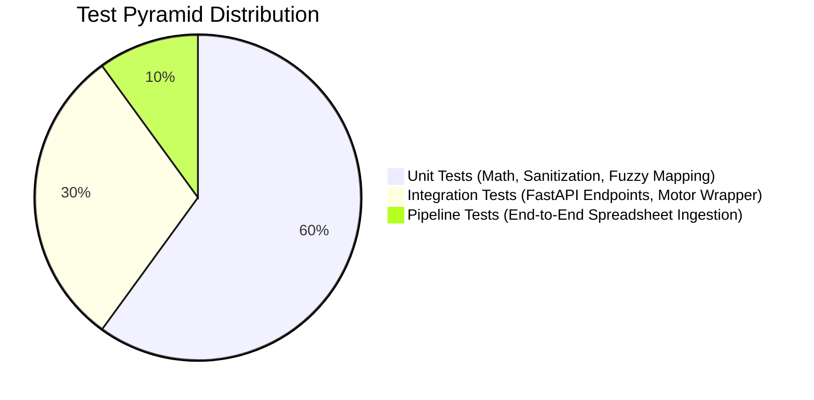

# Code Testing Strategy & Test Pyramid — Citimart Retail Dashboard

**System:** Citimart Retail Analytics & Management Dashboard  
**Document ID:** TEST-CITI-001  
**Version:** 1.1.0  
**Status:** Approved & Implemented Baseline  

---

## 1. Test Strategy & Pyramid

Testing for the Citimart Dashboard focuses heavily on mathematical correctness of analytical calculations, zero-division resilience, spreadsheet sanitization, and ingestion pipeline reliability.



---

## 2. Test Suites Overview

### 2.1 Unit Tests (`backend/tests/test_analytics_and_validation.py`)
Focuses on pure mathematical functions, edge cases, and string sanitizers:
1. **`test_calculate_growth_pct()`**:
   - Standard positive growth: `110.0 vs 100.0 => +10.0%`
   - Negative growth (decline): `79.0 vs 100.0 => -21.0%`
   - Safe division when Last Year is zero: `50.0 vs 0.0 => None` (displayed as "New Entry" in UI)
   - Zero baseline: `0.0 vs 0.0 => 0.0%`
2. **`test_sanitize_csv_cell()`**:
   - Neutralizes dangerous formulas: `=cmd|' /C calc'!A0` => `'=cmd|' /C calc'!A0`
   - Neutralizes plus-sign formulas: `+12345` => `'+12345`
   - Neutralizes minus-sign formulas: `-50` => `'-50`
   - Neutralizes at-sign formulas: `@SUM(A1:A10)` => `'@SUM(A1:A10)`
   - Leaves normal text and numbers untouched: `"Citimart Chowringhee"`, `1599.0`
3. **`test_auto_mapping_aliases()`**:
   - Verifies retail column header aliases:
     - `"Bill Date"` maps to `"date"`
     - `"Store"` maps to `"store_id"`
     - `"Item Code"` maps to `"sku"`
     - `"Sum of Bill Qty"` maps to `"quantity"`
     - `"Sum of Net Amt"` maps to `"net_sales"`

---

### 2.2 Integration Tests (`backend/tests/test_api_endpoints.py`)
Tests FastAPI routers using `httpx.AsyncClient` or FastAPI's `TestClient`:
- Verifies `GET /api/analytics/kpis` returns all 10 management KPIs.
- Verifies `GET /api/analytics/decision-framework` returns the 4 questions.
- Verifies `GET /api/inventory/ageing-buckets` returns the 5 standard retail buckets.
- Verifies `GET /api/settings/db-health` reports database connectivity and collections.

---

### 2.3 Pipeline Tests (`backend/tests/test_upload_pipeline.py`)
Tests the end-to-end spreadsheet upload workflow:
- Template download (`GET /api/upload/templates/{stream}`)
- Header preview and detection (`POST /api/upload/preview`)
- Row validation with intentional dirty rows (`POST /api/upload/validate`)
- Batch commit and database update (`POST /api/upload/commit`)

---

## 3. How to Run Tests

### Running with Backend Virtual Environment
On Windows PowerShell:
```powershell
# Set working directory to project root
cd d:\IT\Citimart_Dashboard

# Set PYTHONPATH to include backend directory
$env:PYTHONPATH = "backend"

# Execute pytest using the virtualenv python
.\backend\venv\Scripts\python.exe -m pytest backend\tests\test_analytics_and_validation.py -v
```

### Running with Code Coverage
```powershell
$env:PYTHONPATH = "backend"
.\backend\venv\Scripts\python.exe -m pytest backend\tests --cov=backend/app --cov-report=term-missing
```

---

## 4. Quality Gates & Release Criteria

Before merging pull requests or issuing production deployments, the following criteria must be satisfied:
- 100% of unit tests in `test_analytics_and_validation.py` must pass.
- Zero unhandled `ZeroDivisionError` exceptions when processing data with zero LY records.
- All exported CSV endpoints must pass formula sanitization assertions.
- Frontend builds cleanly via `npm run build` with zero TypeScript/JSX compilation errors.
