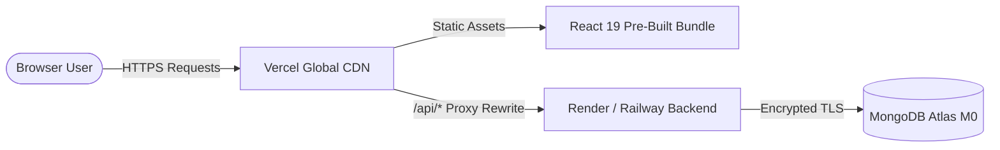

# Production Deployment Guide — Citimart Retail Dashboard

**System:** Citimart Retail Analytics & Management Dashboard  
**Document ID:** DEP-CITI-002  
**Version:** 1.1.0  
**Status:** Approved & Implemented Baseline  

---

## 1. Hosting Architecture Overview

The Citimart Dashboard is deployed using modern, low-cost/free-tier cloud infrastructure:
- **Frontend SPA:** Vercel Edge Network
- **Backend API:** Render / Railway / Fly.io Web Service
- **Persistence:** MongoDB Atlas (M0 Shared Tier)



---

## 2. Frontend Deployment on Vercel

### Step 1: Connect GitHub Repository
1. Log in to [Vercel](https://vercel.com/) and click **"Add New Project"**.
2. Select the `Citimart_Dashboard` GitHub repository.

### Step 2: Configure Project Settings
- **Framework Preset:** Vite
- **Root Directory:** `frontend`
- **Build Command:** `npm run build`
- **Output Directory:** `dist`
- **Install Command:** `npm install`

### Step 3: Configure `vercel.json` API Proxy Rewrite
In `frontend/vercel.json`, ensure the proxy destination points to your live backend domain:

```json
{
  "rewrites": [
    {
      "source": "/api/:path*",
      "destination": "https://citimart-backend.onrender.com/api/:path*"
    }
  ]
}
```

This prevents any Cross-Origin Resource Sharing (CORS) complexity in the browser, allowing the frontend to make relative requests to `/api/...`.

---

## 3. Backend Deployment on Render / Railway

### Step 1: Create New Web Service
1. In the cloud dashboard (e.g. [Render](https://render.com/)), click **"New Web Service"**.
2. Select your repository and configure:
   - **Root Directory:** `backend`
   - **Environment:** `Python 3`
   - **Build Command:** `pip install -r requirements.txt`
   - **Start Command:** `python -m uvicorn app.main:app --host 0.0.0.0 --port $PORT`

### Step 2: Configure Environment Variables
Set the following secrets in the Cloud Dashboard:

| Variable | Recommended Production Value | Description |
| :--- | :--- | :--- |
| `MONGODB_URI` | `mongodb+srv://<username>:<password>@cluster0.mongodb.net/?appName=CitimartProd` | MongoDB Atlas cluster connection string |
| `DATABASE_NAME` | `citimart_retail` | Primary database name |
| `CORS_ORIGINS` | `https://citimart.vercel.app` | Whitelisted Vercel frontend URL |
| `PORT` | `10000` (or automatically provided by cloud host) | Internal listen port |
| `SECRET_KEY` | `generate-random-32-char-string` | Application cryptographic secret |

---

## 4. MongoDB Atlas Provisioning

1. Log in to [MongoDB Atlas](https://cloud.mongodb.com/).
2. Create a new **Free Tier (M0 Shared)** cluster in the closest AWS/GCP region (e.g., `ap-south-1` Mumbai).
3. Under **Database Access**, create a user (e.g. `citimart_app_user`) with read/write privileges on `citimart_retail`.
4. Under **Network Access**, add the IP addresses of your backend web service (or allow `0.0.0.0/0` with strong password authentication).
5. Copy the connection string and assign it to `MONGODB_URI`.

---

## 5. Post-Deployment Verification & Smoke Test

Once both frontend and backend are deployed:

1. **Test Backend Root & Docs:**
   ```bash
   curl -I https://citimart-backend.onrender.com/docs
   ```
   *Expected:* HTTP `200 OK`.

2. **Verify Database Health:**
   ```bash
   curl https://citimart-backend.onrender.com/api/settings/db-health
   ```
   *Expected:* Returns `{"status": "connected", "database_type": "MongoDB Atlas", ...}`.

3. **Verify Frontend UI:**
   Open `https://citimart.vercel.app` in a browser.
   - Confirm Header displays the green database connectivity indicator.
   - Confirm Executive KPIs render with current data.
   - Confirm 4-Questions decision box loads actionable recommendations.
   - Test CSV export from Sales Analysis view.
