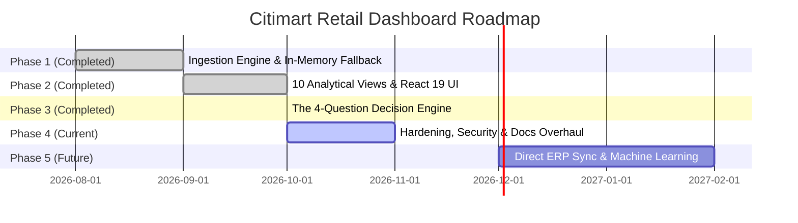

# Strategic Development Plan & Product Roadmap — Citimart Retail Dashboard

**System:** Citimart Retail Analytics & Management Dashboard  
**Document ID:** PLN-CITI-001  
**Version:** 1.1.0  
**Status:** Approved Roadmap  

---

## 1. Delivery Roadmap Overview

---

## 2. Phase Breakdown & Deliverables

### Phase 1: Core Ingestion Engine & Dual-Store Resilience (Completed)
- Built FastAPI backend skeleton with Pydantic v2 schemas.
- Developed `UploadService` with header detection, auto-mapping, and dirty row isolation.
- Implemented `DatabaseManager` with MongoDB Atlas connection and `ResilientInMemoryCollection` fallback store.
- Generated realistic synthetic retail dataset for Citimart (stores, products, vendors, sales, stock).

### Phase 2: 10 Core Analytical Modules & UI (Completed)
- Developed desktop-first React 19 + Vite frontend.
- Created interactive Recharts components for TY vs LY sales trends and department share.
- Integrated Indian number and currency formatters (`₹` Lakhs / Crores).
- Created 10 complete analytical views: Executive Dashboard, Sales Analysis, Inventory & Ageing, Purchases & Vendors, Products, Stores, Alerts, Upload Wizard, Data Quality, Settings.

### Phase 3: The 4-Question Operational Decision Engine (Completed)
- Built AI-grounded root-cause synthesizer answering:
  1. *What happened?*
  2. *Where did it happen?*
  3. *Why did it happen?*
  4. *What action should be taken?*
- Implemented rule-based alerting for fast-runner stock gaps and margin dips with acknowledge/resolve workflow.

### Phase 4: Production Hardening, Security & Testing (Completed)
- Neutralized CSV formula-injection risks (CWE-1236) using `sanitize_csv_cell()`.
- Implemented safe zero-division handling for new product/store growth calculations.
- Configured Vercel production rewrites (`frontend/vercel.json`) and CORS origins whitelist.
- Authored comprehensive test suite covering analytics math and validation.

### Phase 5: Direct ERP Connectors & Predictive ML (Future Roadmap)
- **Direct ERP / Tally / SAP Integration:** Automated scheduled sync bypassing manual Excel uploads.
- **Predictive Demand Forecasting:** Time-series forecasting for festival spikes (Durga Puja, Diwali, Poila Baisakh).
- **Automated Purchase Order Generation:** One-click vendor PO drafting based on reorder thresholds.
