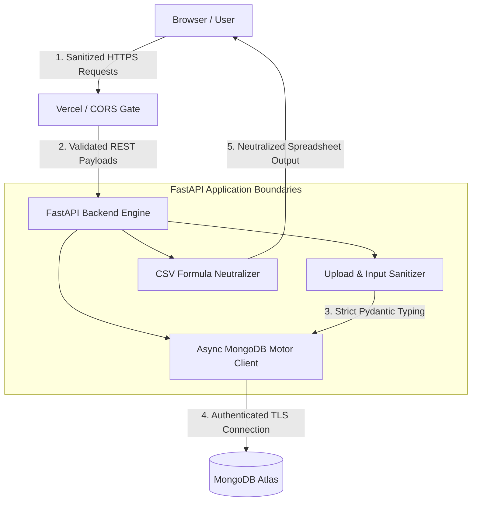

# Security Architecture & Protection Controls — Citimart Retail Dashboard

**System:** Citimart Retail Analytics & Management Dashboard  
**Document ID:** SEC-CITI-001  
**Version:** 1.1.0  
**Status:** Approved & Implemented Baseline  

---

## 1. Threat Model & Security Posture

As a retail intelligence dashboard processing commercial POS registers, inventory balances, and supplier purchase orders, the Citimart Dashboard enforces defense-in-depth across the application lifecycle.



---

## 2. Core Security Controls

### 2.1 Spreadsheet Formula-Injection Neutralization (CWE-1236)
**Risk:** Malicious users or compromised POS terminals could include formulas in text fields (e.g. Product Name `=cmd|'/C calc'!A0` or `-50+@SUM(1,1)`). When an executive exports this data to Microsoft Excel, Excel executes the command or triggers arbitrary dynamic data exchange (DDE) code.

**Protection:** In `backend/app/routers/export.py`, the `sanitize_csv_cell()` function automatically prepends an apostrophe (`'`) to any cell value that starts with dangerous characters:
- Equals sign: `=`
- Plus sign: `+`
- Minus sign: `-`
- At symbol: `@`
- Tab (`\t`) or Carriage Return (`\r`)

```python
def sanitize_csv_cell(value: Any) -> Any:
    if isinstance(value, str) and value.startswith(("=", "+", "-", "@")):
        return f"'{value}"
    return value
```

This ensures Excel renders the value strictly as text and completely disables formula execution.

---

### 2.2 Backend-Only Credential Isolation
**Risk:** Accidental leakage of MongoDB Atlas connection strings or database credentials in client-side bundles.

**Protection:**
- Database URI (`MONGODB_URI`) is defined in `backend/app/config.py` using Pydantic `BaseSettings` and loaded exclusively from server-side environment variables or `.env`.
- The React frontend bundle contains **zero** database connection strings, Atlas cluster URLs, or administrative credentials.
- All database operations are mediated through authenticated FastAPI REST endpoints.

---

### 2.3 File Ingestion & Upload Security
**Risk:** Denial-of-Service via zip bombs, malicious executable uploads, or buffer overflows during spreadsheet parsing.

**Protection:**
1. **File Extension Whitelist:** Only `.xlsx`, `.xls`, and `.csv` extensions are accepted.
2. **File Size Hard Ceiling:** Upload payloads are capped at **25 Megabytes**. Files exceeding this threshold are immediately rejected with HTTP `413 Payload Too Large`.
3. **In-Memory Streaming:** Spreadsheets are read directly into memory buffers via `python-multipart` and parsed using Openpyxl / Pandas without writing temporary executable files to disk.
4. **Row-by-Row Strict Validation:** Before any row is committed to the database, it passes through `validate_stream_data()` which enforces:
   - Positive quantity bounds (negative returns are strictly validated).
   - Date format normalization (`YYYY-MM-DD`).
   - Store and SKU reference sanity checks.

---

### 2.4 Cross-Origin Resource Sharing (CORS) Policy
**Risk:** Cross-site script execution from unauthorized third-party origins.

**Protection:**
- In `backend/app/config.py` and `backend/app/main.py`, CORS is configured with `CORSMiddleware`.
- Local development permits `http://localhost:5173`, `http://127.0.0.1:5173`.
- Production deployments restrict origins to the approved Vercel production domain configured in `CORS_ORIGINS`.

---

### 2.5 Information Disclosure & Error Masking
**Risk:** Leaking internal file paths, stack traces, or database schema structures during runtime exceptions.

**Protection:**
- FastAPI exception handlers catch unhandled server errors and return clean, standardized JSON errors:
```json
{
  "detail": "An internal error occurred during analytical calculation. Please contact IT support."
}
```
- Full diagnostic traces are logged exclusively to the server stdout/log stream via Python's standard `logging` library.
