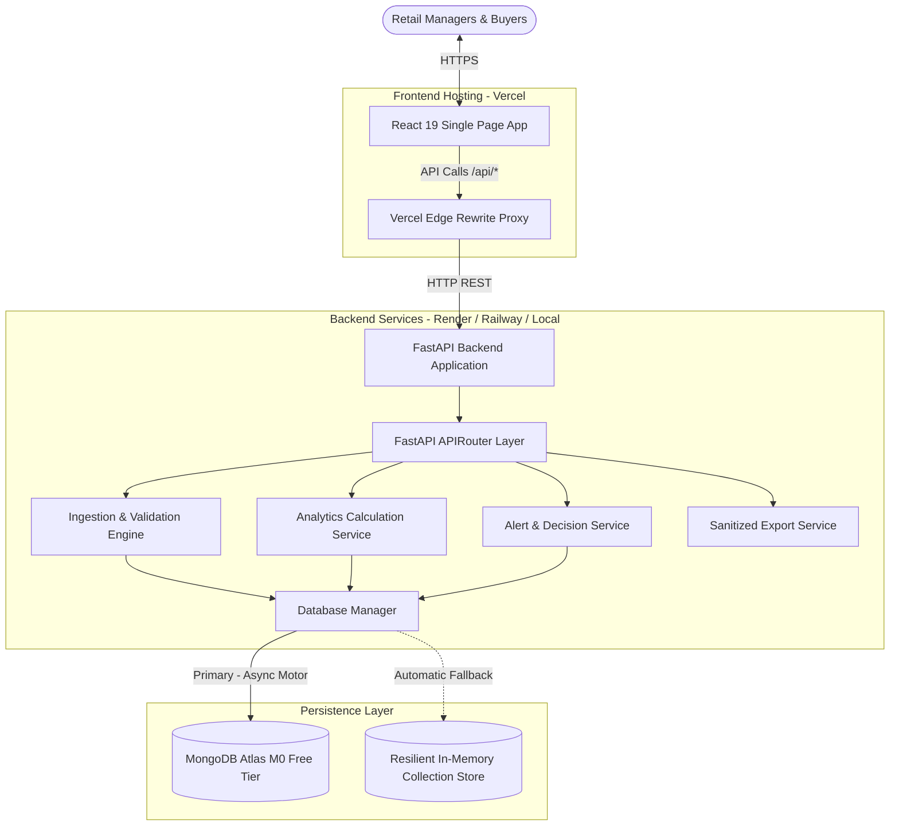
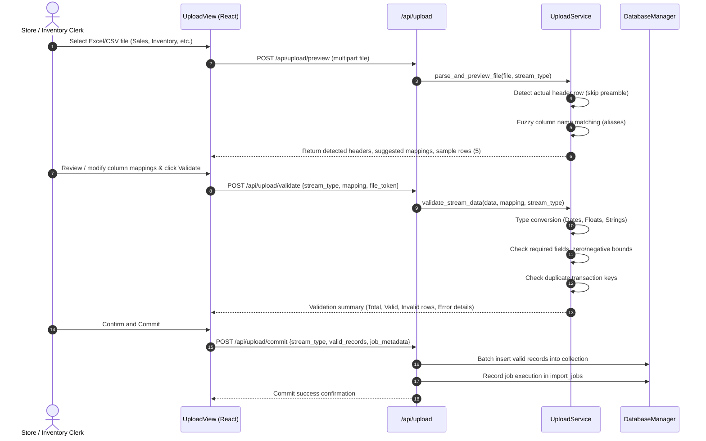
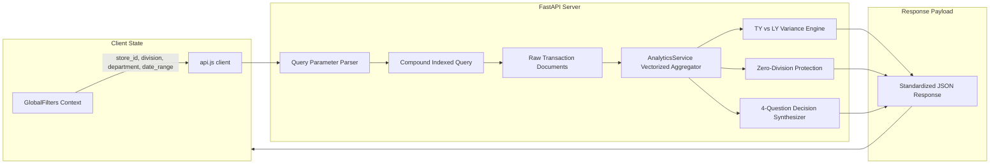
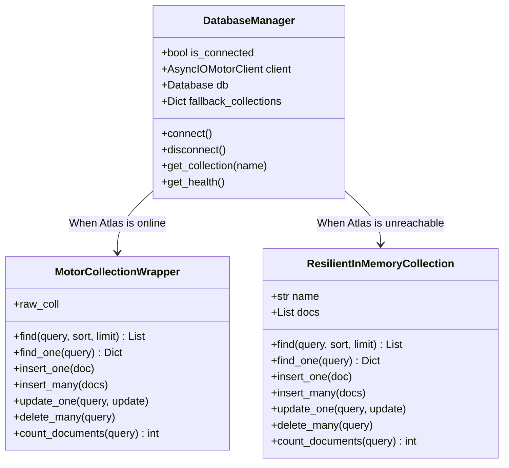

# System Architecture — Citimart Retail Dashboard

**System:** Citimart Retail Analytics & Management Dashboard  
**Document ID:** ARCH-CITI-001  
**Version:** 1.1.0  
**Status:** Approved & Implemented  
**Scope:** Full-stack architecture, ingestion pipeline, data store resilience, and analytics engine.  

---

## 1. System Overview & Context Diagram

The Citimart Dashboard is a high-performance, cost-effective retail intelligence platform. It bridges legacy retail spreadsheet workflows (Excel/CSV POS and stock registers) with modern, sub-second web analytics.



---

## 2. Ingestion & Validation Pipeline Architecture

The ingestion pipeline safely processes raw spreadsheets from multiple POS and ERP exports without crashing on malformed rows or dirty data.



---

## 3. Analytical Calculation Engine & Global Filter Propagation

Analytics queries do not require slow distributed database calculations; instead, FastAPI leverages vectorized Pandas computations and indexed MongoDB queries to achieve `< 300ms` responses.



---

## 4. Dual-Store Persistence & Resilience Architecture

To ensure zero downtime during demo presentations, development without an Atlas connection string, or transient MongoDB connection dropouts, the system utilizes an automatic resilience pattern:



### Operational Guarantees:
1. **Seamless Fallback:** When `client.admin.command('ping')` times out (>4000ms), `is_connected` is set to `False`. All `get_collection(name)` calls transparently return a `ResilientInMemoryCollection`.
2. **Consistent Interface:** Both `MotorCollectionWrapper` and `ResilientInMemoryCollection` share an identical asynchronous API (`find()`, `find_one()`, `insert_many()`, `update_one()`, `count_documents()`), preventing any router or service from throwing interface mismatch errors.
3. **Out-of-the-Box Demo Seeding:** When running in fallback mode, the backend auto-populates rich demo retail datasets for Citimart (stores across Kolkata, Asansol, Siliguri; fashion apparel hierarchy, sales, stock, purchases).

---

## 5. Security & Isolation Boundaries

- **Database Isolation:** Database credentials (`MONGODB_URI`) reside exclusively in backend environment variables. The frontend client has zero awareness of connection strings or credentials.
- **Data Neutralization:** CSV exports run through `sanitize_csv_cell()` in `export.py` to strip formula-injection vectors (`=`, `+`, `-`, `@`).
- **File Upload Protection:** Uploads are parsed in-memory with file size limits (25MB), strict content-type verification, and secure extension matching (`.xlsx`, `.xls`, `.csv`).

---

## 6. Project Directory Structure

```text
D:\IT\Citimart_Dashboard
├── README.md                      # Quickstart and project reference
├── docs/                          # Authoritative specifications and documentation
│   ├── INDEX.md                   # Documentation master catalog
│   ├── prd.md                     # Product requirements document
│   ├── system-architecture.md     # Architecture & system design (this file)
│   ├── tech-stacks.md             # Technology inventory & decisions
│   ├── database.md                # Persistence contracts & schemas
│   ├── apis.md                    # REST API specifications
│   ├── design.md                  # UI/UX design contract
│   ├── security.md                # Security architecture & protection
│   ├── code-testing.md            # Testing pyramid & execution guide
│   ├── adrs/                      # Architecture Decision Records
│   └── features/                  # Feature specifications
├── backend/                       # FastAPI Backend
│   ├── app/
│   │   ├── config.py              # Pydantic BaseSettings configuration
│   │   ├── database.py            # Motor client & Resilient InMemory fallback
│   │   ├── main.py                # FastAPI initialization, CORS & router mount
│   │   ├── models/schemas.py      # Pydantic data schemas
│   │   ├── routers/               # Modular REST route handlers
│   │   │   ├── analytics.py       # KPIs, trends, store rankings, 4-questions
│   │   │   ├── inventory.py       # Ageing buckets & velocity summary
│   │   │   ├── purchases.py       # Vendor concentration & intake ratios
│   │   │   ├── alerts.py          # Alert management & thresholds
│   │   │   ├── upload.py          # Ingestion wizard endpoints
│   │   │   ├── export.py          # Sanitized CSV export endpoints
│   │   │   └── settings.py        # Health check, reseed, metrics glossary
│   │   └── services/              # Business logic & computation
│   │       ├── analytics_service.py # Vectorized KPI calculations
│   │       ├── alert_service.py     # Rule-based alert trigger engine
│   │       ├── upload_service.py    # Auto-header mapping & row validation
│   │       └── seed_data.py         # Retail demo generator
│   ├── tests/                     # Pytest test suite
│   │   ├── test_analytics_and_validation.py # Unit tests
│   │   └── test_upload_pipeline.py          # Integration tests
│   └── requirements.txt           # Python dependency specifications
└── frontend/                      # React 19 Frontend
    ├── src/
    │   ├── components/            # Header, GlobalFilters, KPICard, DecisionCard
    │   ├── pages/                 # 10 Analytical views (Executive, Sales, etc.)
    │   ├── services/api.js        # Axios API client wrapper
    │   └── utils/formatters.js    # Indian number & currency formatters
    ├── package.json               # NPM packages & build scripts
    └── vercel.json                # Vercel proxy configuration
```
